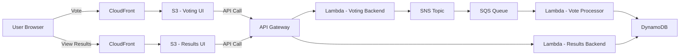

<div align="center">

# 🗳️ MyVote AWS

### A Cloud-Native Serverless Voting Application

[](https://aws.amazon.com/)
[](https://www.terraform.io/)
[](https://www.python.org/)
[](https://developer.mozilla.org/en-US/docs/Web/JavaScript)
[](LICENSE)

[Features](#-features) • [Architecture](#-architecture) • [Quick Start](#-quick-start) • [Deployment](#-deployment) • [Components](#-components) • [Configuration](#-configuration)

</div>

---

## 📋 Overview

**MyVote AWS** is a modern, scalable, and fully serverless voting application built on AWS infrastructure. This project demonstrates best practices for cloud-native application development, featuring a decoupled microservices architecture with real-time results visualization.

The application enables users to:
- 🗳️ Cast votes between two options (A or B)
- 📊 View real-time voting results with animated visualizations
- 🔄 Process votes asynchronously through message queues
- 💾 Store vote data persistently in a NoSQL database

---

## ✨ Features

### Core Functionality
- **Real-time Voting Interface** - Responsive web UI for casting votes
- **Live Results Dashboard** - Auto-updating visualization of voting statistics
- **Asynchronous Processing** - Decoupled vote processing via SQS queues
- **Persistent Storage** - DynamoDB for scalable data persistence
- **Event-Driven Architecture** - SNS notifications for system events

### Technical Highlights
- ☁️ **100% Serverless** - No server management required
- 🚀 **Auto-scaling** - Handles variable load automatically
- 🔒 **Secure by Design** - IAM policies and VPC configuration
- 📦 **Infrastructure as Code** - Terraform and CloudFormation templates
- 🌐 **Global CDN** - CloudFront distribution for low-latency access
- 💰 **Cost-Optimized** - Pay only for what you use

---

## 🏗️ Architecture

### System Architecture Diagram


### Serverless Architecture (Terraform Implementation)


### Component Flow



### Request Flow

1. **Vote Submission**
   - User clicks A or B on the voting interface
   - Request sent via API Gateway to Voting Lambda
   - Lambda publishes vote event to SNS topic
   - SNS forwards message to SQS queue
   - Vote Processor Lambda consumes from queue
   - Vote stored in DynamoDB

2. **Results Display**
   - Results page polls API Gateway every 3 seconds
   - Results Lambda queries DynamoDB
   - Aggregated vote counts returned to frontend
   - UI updates with animated percentage bars

---

## 🛠️ Technology Stack

### AWS Services

| Service | Purpose | Configuration |
|---------|---------|---------------|
| **S3** | Static website hosting | Two buckets for voting and results frontends |
| **CloudFront** | Content delivery network | Global edge caching |
| **API Gateway** | RESTful API endpoints | CORS-enabled, public access |
| **Lambda** | Serverless compute | Python 3.x runtime |
| **DynamoDB** | NoSQL database | On-demand billing mode |
| **SQS** | Message queue | Standard queue with DLQ |
| **SNS** | Pub/Sub notifications | Topic for vote events |
| **IAM** | Access management | Least-privilege policies |
| **VPC** | Network isolation | Optional for enhanced security |

### Application Stack

- **Frontend**: HTML5, CSS3, JavaScript (jQuery)
- **Backend**: Python 3.x with boto3
- **IaC**: Terraform, CloudFormation, AWS CDK
- **CI/CD**: Ready for GitHub Actions integration

---

## 🚀 Quick Start

### Prerequisites

- AWS Account with appropriate permissions
- AWS CLI configured with credentials
- Terraform >= 1.0 (for Terraform deployment)
- Python 3.8+ (for local testing)
- Node.js (optional, for local development server)

### Local Development

1. **Clone the repository**
   ```bash
   git clone https://github.com/D1L5H4N/My-Vote.git
   cd My-Vote
   ```

2. **Run frontends locally**
   ```bash
   # Voting frontend (port 8080)
   cd voting-frontend
   python -m http.server 8080

   # Results frontend (port 8081)
   cd result-frontend
   python -m http.server 8081
   ```

3. **Access the application**
   - Voting: http://localhost:8080
   - Results: http://localhost:8081

> ⚠️ **Note**: Frontends require backend APIs to be deployed on AWS for full functionality.

---

## 📦 Deployment

### Option 1: Terraform (Recommended)

```bash
cd iac

# Initialize Terraform
terraform init

# Review the execution plan
terraform plan

# Apply the infrastructure
terraform apply

# Note the output URLs for frontends and API endpoints
```

### Option 2: CloudFormation

```bash
cd iac/cloudformation

# Deploy the stack
aws cloudformation create-stack \
  --stack-name myvote-app \
  --template-body file://myvote_cf.yaml \
  --capabilities CAPABILITY_IAM

# Monitor deployment
aws cloudformation describe-stacks --stack-name myvote-app
```

### Option 3: AWS CDK

```bash
cd iac_done_former2

# Install dependencies
pip install -r requirements.txt

# Deploy
cdk deploy
```

### Post-Deployment Configuration

After deployment, update the API Gateway endpoints in:

1. **Voting Frontend** (`voting-frontend/index.html`)
   ```javascript
   var backend_url = "YOUR_API_GATEWAY_URL/voting"
   ```

2. **Results Frontend** (`result-frontend/app.js`)
   ```javascript
   var backend_url = "YOUR_API_GATEWAY_URL/results"
   ```

---

## 🧩 Components

### Frontend Components

#### 1. Voting Frontend
- **Location**: `./voting-frontend`
- **Tech**: HTML, CSS, JavaScript (jQuery)
- **Features**: 
  - Simple A/B voting interface
  - Vote confirmation feedback
  - Responsive design
- **Entry Point**: `index.html`

#### 2. Results Frontend
- **Location**: `./result-frontend`
- **Tech**: HTML, CSS, JavaScript (jQuery)
- **Features**:
  - Real-time results polling (3s interval)
  - Animated percentage bars
  - Vote count display
- **Entry Point**: `index.html`, `app.js`

### Backend Components

#### 3. Voting Backend (Lambda)
- **Location**: `./voting-backend`
- **Runtime**: Python 3.x
- **Function**: 
  - Receives vote submissions
  - Publishes to SNS topic
  - Returns success/error response
- **IAM Policy**: SNS Publish permissions
- **Handler**: `voting.lambda_handler`

#### 4. Vote Processor (Lambda/EC2)
- **Location**: `./vote-processor`
- **Runtime**: Python 3.x
- **Function**:
  - Consumes messages from SQS queue
  - Processes vote data
  - Writes to DynamoDB
- **IAM Policy**: SQS Read, DynamoDB Write
- **Handler**: `processor_lambda.lambda_handler`

#### 5. Results Backend (Lambda)
- **Location**: `./result-backend`
- **Runtime**: Python 3.x
- **Function**:
  - Queries DynamoDB for vote counts
  - Aggregates results
  - Returns JSON response
- **IAM Policy**: DynamoDB Read permissions
- **Handler**: `results.lambda_handler`

### Infrastructure Components

#### 6. API Gateway
- **Location**: `./gateway`
- **Endpoints**:
  - `POST /voting` - Submit vote
  - `GET /results` - Fetch results
- **Configuration**: CORS enabled, Public access

#### 7. DynamoDB
- **Location**: `./dynamodb`
- **Table Name**: `Votes`
- **Primary Key**: Custom partition key
- **Billing Mode**: On-demand
- **Features**: Point-in-time recovery enabled

---

## ⚙️ Configuration

### Environment Variables

#### Voting Backend
```python
SNS_TOPIC_ARN = "arn:aws:sns:REGION:ACCOUNT:vote-topic"
```

#### Vote Processor
```python
SQS_QUEUE_URL = "https://sqs.REGION.amazonaws.com/ACCOUNT/vote-queue"
DYNAMODB_TABLE = "Votes"
```

#### Results Backend
```python
DYNAMODB_TABLE = "Votes"
```

### IAM Policies

Detailed IAM policies are provided in component README files:
- [Voting Backend IAM](./voting-backend/README.md)
- [Vote Processor IAM](./vote-processor/README.md)
- [Results Backend IAM](./result-backend/README.md)

---

## 🔒 Security Best Practices

- ✅ **Least Privilege IAM Roles** - Each Lambda has minimal required permissions
- ✅ **API Gateway Throttling** - Rate limiting enabled
- ✅ **CORS Configuration** - Restricted to specific origins
- ✅ **CloudFront HTTPS** - SSL/TLS encryption in transit
- ✅ **DynamoDB Encryption** - Encryption at rest enabled
- ✅ **VPC Configuration** - Network isolation for sensitive components

---

## 💰 Cost Estimation

### Monthly Cost Breakdown (Estimated)

| Service | Usage | Cost |
|---------|-------|------|
| Lambda | 1M requests, 128MB | ~$0.20 |
| API Gateway | 1M requests | ~$3.50 |
| DynamoDB | 1GB storage, on-demand | ~$1.25 |
| S3 | 1GB storage, 10K requests | ~$0.50 |
| CloudFront | 10GB transfer | ~$1.00 |
| **Total** | | **~$6.45/month** |

> 💡 **Tip**: Use AWS Free Tier for initial testing to minimize costs.

---

## 🧪 Testing

### Local Testing

```bash
# Test voting backend locally
cd voting-backend
python voting.py

# Test results backend locally
cd result-backend
python results.py

# Test vote processor locally
cd vote-processor
python processor.py
```

### Integration Testing

```bash
# Submit a test vote
curl -X POST https://YOUR_API_GATEWAY/voting \
  -H "Content-Type: application/json" \
  -d '{"MessageAttributes":{"vote":{"Type":"String","StringValue":"a"},"voter":{"Type":"String","StringValue":"test"}}}'

# Fetch results
curl https://YOUR_API_GATEWAY/results
```

---

## 🐛 Troubleshooting

### Common Issues

**Issue**: Frontend shows "error ! :(" when voting
- **Solution**: Check API Gateway URL is correctly configured
- **Solution**: Verify Lambda has SNS publish permissions
- **Solution**: Check CloudWatch logs for Lambda errors

**Issue**: Results not updating
- **Solution**: Verify SQS queue is processing messages
- **Solution**: Check Vote Processor Lambda CloudWatch logs
- **Solution**: Confirm DynamoDB table exists and is accessible

**Issue**: CORS errors in browser console
- **Solution**: Enable CORS on API Gateway endpoints
- **Solution**: Add proper headers in Lambda responses

### CloudWatch Logs

Monitor Lambda execution:
```bash
# View logs for voting Lambda
aws logs tail /aws/lambda/voting-backend --follow

# View logs for results Lambda
aws logs tail /aws/lambda/results-backend --follow

# View logs for vote processor
aws logs tail /aws/lambda/vote-processor --follow
```

---

## 📚 Documentation

- [Architecture Deep Dive](./docs/ARCHITECTURE.md) _(Coming Soon)_
- [Deployment Guide](./docs/DEPLOYMENT.md) _(Coming Soon)_
- [API Reference](./docs/API.md) _(Coming Soon)_
- [Contributing Guidelines](./docs/CONTRIBUTING.md) _(Coming Soon)_

---

## 🤝 Contributing

Contributions are welcome! Please follow these steps:

1. Fork the repository
2. Create a feature branch (`git checkout -b feature/AmazingFeature`)
3. Commit your changes (`git commit -m 'Add some AmazingFeature'`)
4. Push to the branch (`git push origin feature/AmazingFeature`)
5. Open a Pull Request

---

## 📝 License

This project is licensed under the MIT License - see the [LICENSE](LICENSE) file for details.

---

## 👨‍💻 Author

**D1L5H4N**
- GitHub: [@D1L5H4N](https://github.com/D1L5H4N)
- Repository: [My-Vote](https://github.com/D1L5H4N/My-Vote)

---

## 🙏 Acknowledgments

- Original concept and architecture design
- AWS documentation and best practices
- Open-source community contributions

---

## 📞 Support

If you encounter any issues or have questions:

1. Check the [Troubleshooting](#-troubleshooting) section
2. Review [existing issues](https://github.com/D1L5H4N/My-Vote/issues)
3. Open a [new issue](https://github.com/D1L5H4N/My-Vote/issues/new) with detailed information

---

<div align="center">

**⭐ Star this repository if you find it helpful!**

Made with ❤️ using AWS Serverless Technologies

</div>

